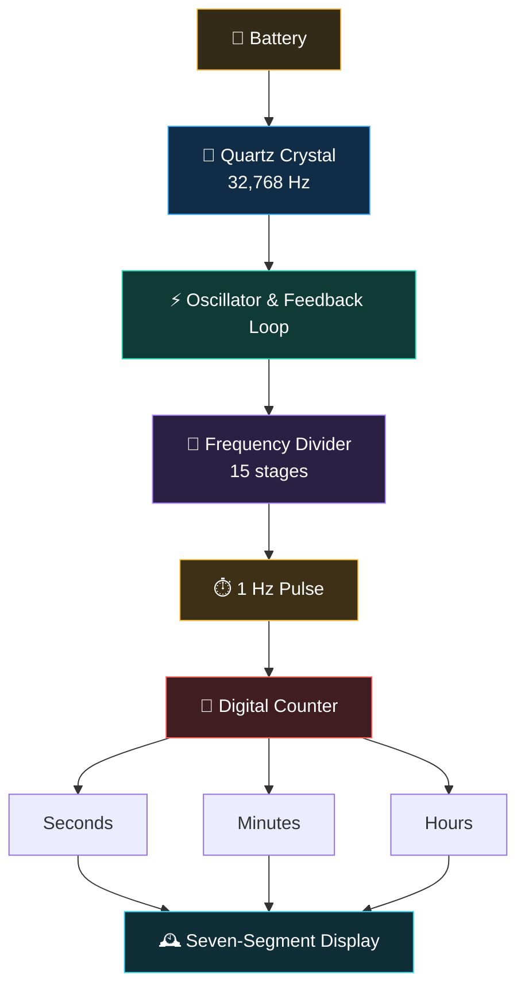

  

📟 **QronoX**

**Interactive Quartz Clock Simulator**

> QronoX simulates how quartz vibrations power digital timekeeping, from frequency division to display and accuracy.

🔮 Quartz Oscillation · ⚡ Frequency Division · ⏱️ Digital Timekeeping

🕔 [**Explore the Simulation**](https://qronox.stark-kodex.workers.dev)

---

📃 **Features**

⚡ **Frequency Division**

A 32,768 Hz clock signal can be divided by (2^{15}) to produce a 1 Hz signal.

$$
32768 = 2^{15}
$$

Step-by-step division:

$$
\begin{aligned}
32768 &\div 2 = 16384\
16384 &\div 2 = 8192\
8192 &\div 2 = 4096\
4096 &\div 2 = 2048\
2048 &\div 2 = 1024\
1024 &\div 2 = 512\
512 &\div 2 = 256\
256 &\div 2 = 128\
128 &\div 2 = 64\
64 &\div 2 = 32\
32 &\div 2 = 16\
16 &\div 2 = 8\
8 &\div 2 = 4\
4 &\div 2 = 2\
2 &\div 2 = 1
\end{aligned}
$$

Result:

$$
\frac{32768\ \text{Hz}}{2^{15}} = 1\ \text{Hz}
$$

Each division by 2 halves the frequency. After 15 divisions, the output is a 1 Hz signal, producing one cycle per second.
---

👨🏻‍💻 **Technology**

**HTML** · **CSS** · **JavaScript** ·**SVG** · **Canvas API**

---

📜 License

This project is licensed under the MIT License. See the [LICENSE](LICENSE) file for details.
