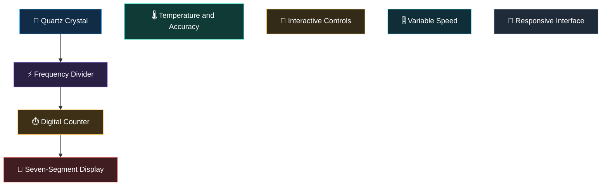
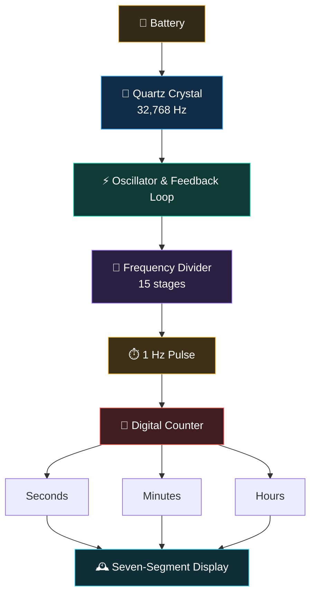

  

📟 **QronoX**

**Interactive Quartz Clock Simulator**

> QronoX simulates how quartz vibrations power digital timekeeping, from frequency division to display and accuracy.

🔮 Quartz Oscillation · ⚡ Frequency Division · ⏱️ Digital Timekeeping

🕔 [**Explore the Simulation**](https://YOUR-CLOUDFLARE-PROJECT.pages.dev/)

---

✦ **Features**

---

📃 **Working Principle**

📝 **Frequency Division**

$$
32768 = 2^{15}
$$

$$
\frac{32768\ \text{Hz}}{2^{15}} = 1\ \text{Hz}
$$

---

👨🏻‍💻 **Technology**

**HTML** · **CSS** · **JavaScript** ·**SVG** · **Canvas API**

---

📜 License

This project is licensed under the MIT License. See the [LICENSE](LICENSE) file for details.
