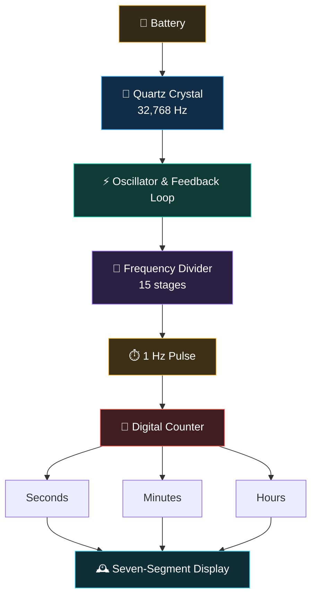

  

🕰️ **QronoX**

Interactive Quartz Clock Simulator

> QronoX simulates how quartz vibrations power digital timekeeping, from frequency division to display and accuracy.

🔮 Quartz Oscillation · ⚡ Frequency Division · ⏱️ Digital Timekeeping

🔬 **Explore the Simulation**

---

✦ **Features**

- 💎 Quartz crystal: explore tuning-fork vibration, electrode polarity and feedback amplification
- ⚡ Frequency divider: visualize 15 stages reducing 32,768 Hz to 1 Hz
- ⏱️ Digital counter: observe seconds, minutes, hours and counter rollover
- 🔢 Seven-segment display: explore how numerical digits are represented
- 🌡️ Temperature and accuracy: investigate modeled frequency drift and timekeeping error
- 🔋 Interactive controls: remove the battery, synchronize the watch, and freeze or resume the simulation
- 🎚️ Variable speed: slow crystal oscillations for easier observation
- 📚 Guided learning tour: explore the working principles step by step
- 📱 Responsive interface: works on desktop and mobile

---

📃 **Principle**

---

## 📃 Principle

### 🔢 Frequency Division

The quartz crystal oscillates at 32,768 Hz. Fifteen successive divide-by-two stages produce one pulse per second.

$$
32768 = 2^{15}
$$

$$
\frac{32768\ \text{Hz}}{2^{15}} = 1\ \text{Hz}
$$

📟 **Frequency Division**

$$
32768 = 2^{15}
$$

$$
\frac{32768\ \text{Hz}}{2^{15}} = 1\ \text{Hz}
$$

---

👨🏻‍💻 **Technology**

HTML · CSS · JavaScript · SVG · Canvas API

- Visualization: SVG-based crystal, circuit and seven-segment illustrations
- Graphing: Canvas-based temperature–frequency curve
- Typography: IBM Plex Sans and Roboto
- Architecture: browser-native technologies without a JavaScript framework

---

📜 License

This project is licensed under the MIT License. See the [LICENSE](LICENSE) file for details.
