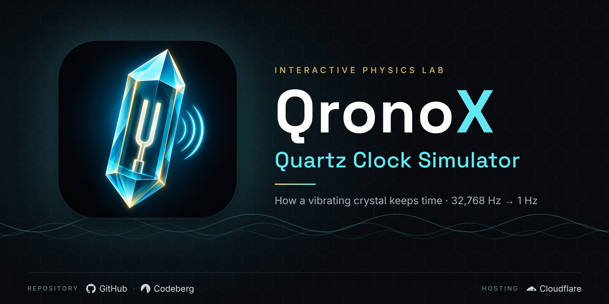

  

<h1 align="center">💎 QronoX</h1>

<h3 align="center"><em>Interactive Quartz Clock Simulator</em></h3>

  QronoX simulates how quartz vibrations power digital timekeeping, from frequency division to display and accuracy.

  💎 Quartz Oscillation · ⚡ Frequency Division · ⏱️ Digital Timekeeping

  🔬 <a href="YOUR_ACTUAL_DEMO_URL"><strong>Explore the Simulation</strong></a>

---

## ✦ Features

- 💎 **Quartz Crystal:** Explore tuning-fork vibration, electrode polarity, and feedback amplification.
- ⚡ **Frequency Divider:** Visualize 15 stages reducing 32,768 Hz to 1 Hz.
- ⏱️ **Digital Counter:** Observe seconds, minutes, hours, and counter rollover.
- 🔢 **Seven-Segment Display:** Explore how numerical digits are represented.
- 🌡️ **Temperature and Accuracy:** Investigate modeled frequency drift and timekeeping error.
- 🔋 **Interactive Controls:** Remove the battery, synchronize the watch, and freeze or resume the simulation.
- 🎚️ **Variable Speed:** Slow crystal oscillations for easier observation.
- 📚 **Guided Learning Tour:** Explore the working principles step by step.
- 📱 **Responsive Interface:** Works on desktop and mobile.

---

## 💎 Working Principle

1. **Battery:** Supplies electrical energy to the circuit.
2. **Quartz Crystal:** Vibrates at its natural frequency through the piezoelectric effect.
3. **Oscillator:** Sustains vibration through an amplifier and feedback loop.
4. **Frequency Divider:** Halves the frequency across 15 stages.
5. **Counter:** Converts 1 Hz pulses into seconds, minutes, and hours.
6. **Display:** Represents time using seven-segment digits.

### Frequency Division

$$
32768 = 2^{15}
$$

$$
\frac{32768\ \text{Hz}}{2^{15}} = 1\ \text{Hz}
$$

---

## ⚙️ Technology

HTML · CSS · JavaScript · SVG · Canvas API

- **Visualization:** SVG-based crystal, circuit, and seven-segment illustrations.
- **Graphing:** Canvas-based temperature–frequency curve.
- **Typography:** IBM Plex Sans and Roboto.
- **Architecture:** Browser-native technologies without a JavaScript framework.

---

## 📜 License

This project is licensed under the MIT License. See the [LICENSE](LICENSE) file for details.
